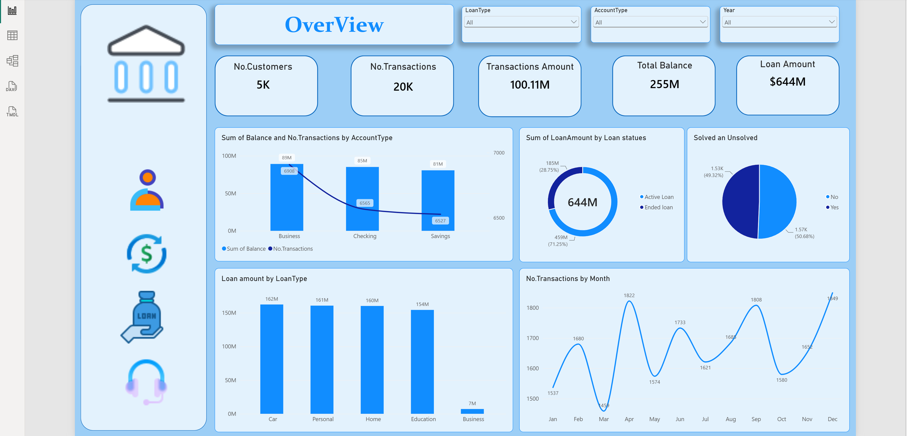
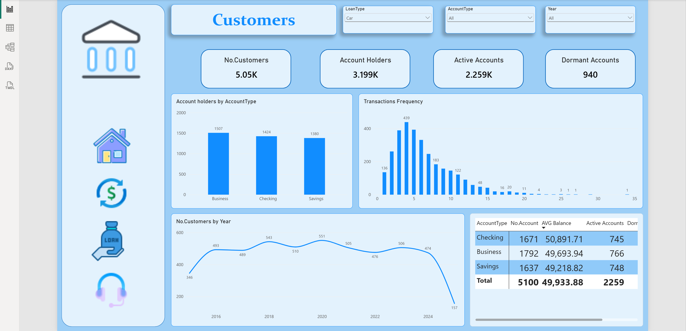
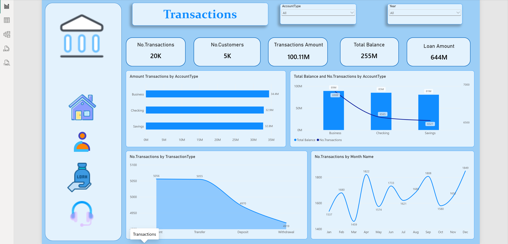
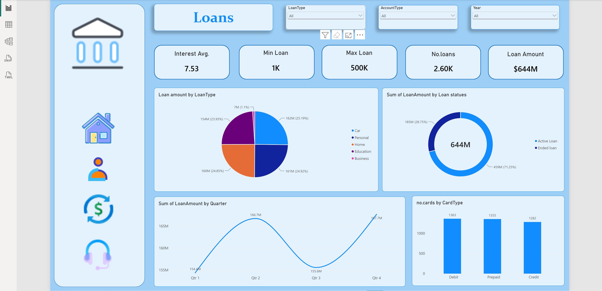
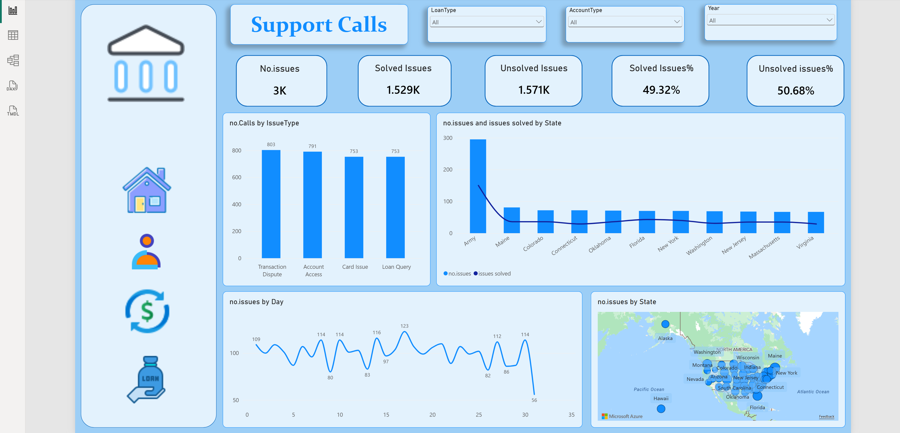

# Banking Customer Operations Analytics

## Overview
An end-to-end Power BI project analyzing a retail bank's customers, transactions, loans, and customer support operations. The dashboard helps management monitor performance, understand customer behavior, track loan exposure, and identify service gaps.

## Download
[Power BI file (.pbix)](Banking_analysis_project.pbix)

## Tools
Power BI, Power Query, DAX, Data Modeling

## Business Questions
- How many customers, accounts, and transactions does the bank have, and how are they distributed by account type?
- How active is the customer base, and how many accounts are dormant?
- How is the loan portfolio split by loan type, status, and quarter?
- When do transaction volumes peak during the year?
- How well is customer support resolving issues, and where do most issues come from?

## Key Insights
- The bank serves about 5K customers with 20K transactions worth 100.11M, with a total balance of 255M and a loan portfolio of 644M.
- Business accounts lead in both total balance (89M) and transaction amount (34.4M), followed by Checking (85M) and Savings (81M).
- 940 accounts (about 29% of the 3,199 account holders) are dormant, which is a clear reactivation opportunity.
- Customer growth peaked around 2020 (551 new customers) and then declined, with 2024 showing the lowest numbers (partial year).
- Transactions peak in December (1,849) and April (1,822), with the lowest in March (1,459).
- Loans are spread almost evenly across Car (162M), Personal (161M), Home (160M), and Education (154M); Business loans are only 7M (1.1%).
- 71.25% of the loan amount (459M) is in active loans and 28.75% (185M) in ended loans.
- Loan issuance rises in Q2 (166.7M) and Q4 (167.7M), and dips in Q3 (155.6M).
- Only 49.32% of customer support issues are solved, leaving 50.68% (1,571 issues) unresolved.
- Support issues are evenly spread across issue types (Transaction Dispute 803, Account Access 791, Card Issue 753, Loan Query 753), so the problem is general rather than tied to one category.

## Dashboard

### Page 1: Overview

### Page 2: Customers

### Page 3: Transactions

### Page 4: Loans

### Page 5: Support Calls

## Recommendations
- Launch a reactivation campaign for the 940 dormant accounts (offers, reminders, or fee waivers).
- Improve customer support resolution, since half of all issues remain unsolved: add staffing or an escalation process, and set a target resolution rate (for example 80% or more).
- Prepare for transaction peaks in April and December by making sure systems and support teams can handle higher volume.
- Consider growing the Business loan segment, which is very small (1.1%) compared to other loan types.
- Review why new customer numbers declined after 2020 and plan acquisition campaigns.
- Monitor the active loan portfolio (459M) closely for repayment risk.
